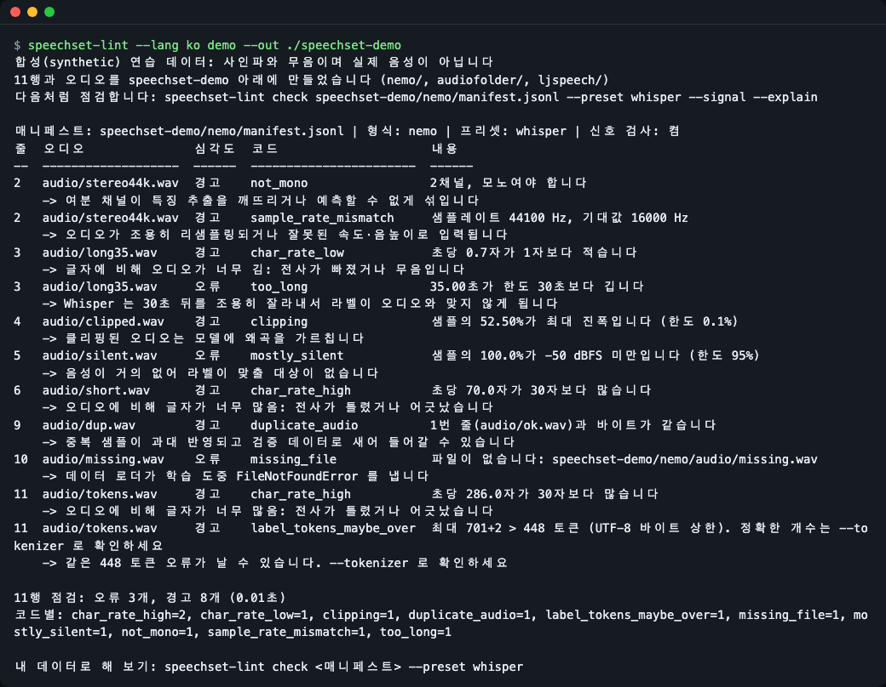
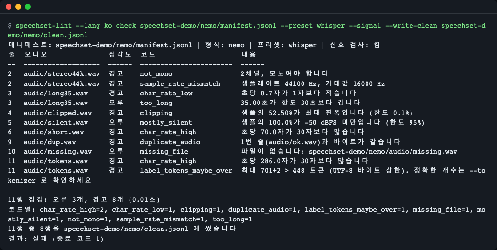
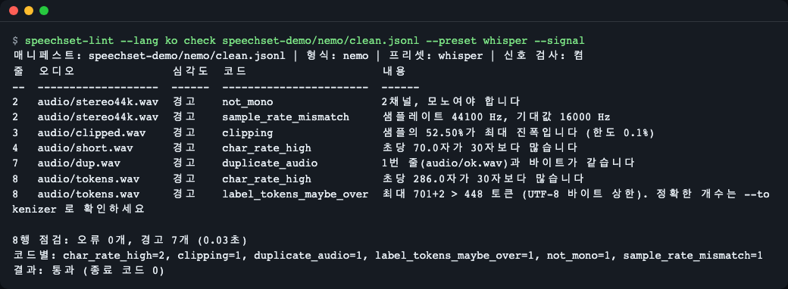
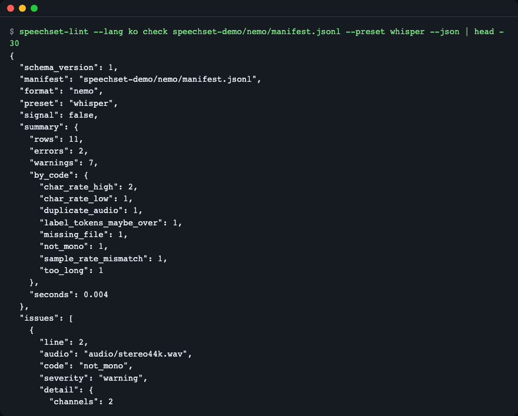
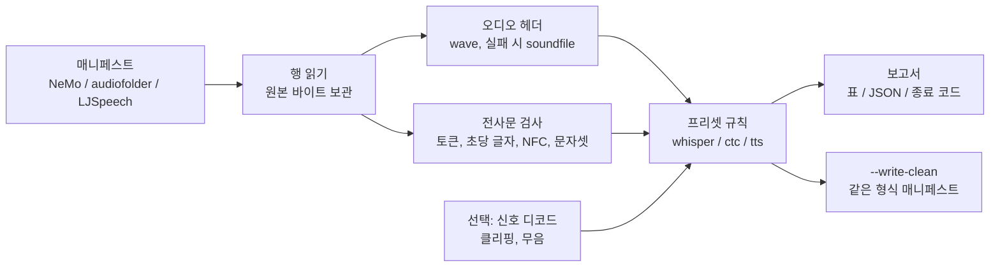

# speechset-lint

[English](README.md) | **한국어**

음성 파인튜닝 데이터셋을 학습 전에 점검하는 린터입니다. 명령 하나로 매니페스트(NeMo JSONL, Hugging Face audiofolder, LJSpeech)를 변환 없이 읽고, Whisper·wav2vec2 CTC·TTS 학습에 맞춰 오디오 헤더와 전사문을 검사해 줄 번호와 이유가 붙은 보고서를 보여 줍니다. 문제 행을 뺀 같은 형식의 매니페스트도 쓸 수 있습니다. torch는 필요 없습니다.

학습 몇 시간 뒤에야 터지는 `size of tensor a (449) must match the size of tensor b (448)`, CTC 손실이 `inf`가 되는 문제, Whisper가 30초 넘는 소리를 조용히 잘라 버리는 문제를 미리 잡아 줍니다.


*내장 demo가 합성 연습 데이터셋(사인파와 무음, 실제 음성 아님)을 만들고 10가지 문제를 줄 번호와 이유와 함께 보여 줍니다.*

## 이런 분께
- Whisper를 파인튜닝하기 전에 30초를 넘거나 라벨이 448 토큰을 넘는 클립을 찾고 싶은 분
- wav2vec2를 CTC로 학습하는데, 손실이 `inf`가 되기 전에 오디오에 비해 전사문이 너무 긴 행을 찾고 싶은 분
- LJSpeech 형식 TTS 데이터셋에서 샘플레이트 불일치, 스테레오, 클리핑·무음 클립, 중복을 찾고 싶은 분
- 데이터셋 매니페스트에 오류가 있으면 실패하는 CI 단계가 필요한 분

## 설치
```bash
# 전제 도구: uv (https://docs.astral.sh/uv/)
curl -LsSf https://astral.sh/uv/install.sh | sh
uv tool install git+https://github.com/LeeGyeongPil/speechset-lint
# 선택: tokenizer.json 으로 라벨 토큰 수를 정확히 계산
uv tool install "speechset-lint[tokens] @ git+https://github.com/LeeGyeongPil/speechset-lint"
```
PyPI에서도 `pip install speechset-lint`(추가 기능: `pip install "speechset-lint[tokens]"`)로 설치할 수 있습니다.

Python 3.11 이상이 필요합니다. 오디오 읽기는 `soundfile`을 쓰며 대부분의 플랫폼에서 libsndfile이 함께 들어 있습니다. 최소 리눅스 이미지에서 `import soundfile`이 실패하면 `libsndfile1`을 설치하세요.

## 빠르게 시작하기
```bash
speechset-lint --lang ko demo --out ./speechset-demo
```
```text
합성(synthetic) 연습 데이터: 사인파와 무음이며 실제 음성이 아닙니다
11행과 오디오를 speechset-demo 아래에 만들었습니다 (nemo/, audiofolder/, ljspeech/)
다음처럼 점검합니다: speechset-lint check speechset-demo/nemo/manifest.jsonl --preset whisper --signal --explain

매니페스트: speechset-demo/nemo/manifest.jsonl | 형식: nemo | 프리셋: whisper | 신호 검사: 켬
줄  오디오               심각도  코드                     내용
--  -------------------  ------  -----------------------  ------
2   audio/stereo44k.wav  경고    not_mono                 2채널, 모노여야 합니다
    -> 여분 채널이 특징 추출을 깨뜨리거나 예측할 수 없게 섞입니다
2   audio/stereo44k.wav  경고    sample_rate_mismatch     샘플레이트 44100 Hz, 기대값 16000 Hz
    -> 오디오가 조용히 리샘플링되거나 잘못된 속도·음높이로 입력됩니다
3   audio/long35.wav     경고    char_rate_low            초당 0.7자가 1자보다 적습니다
    -> 글자에 비해 오디오가 너무 김: 전사가 빠졌거나 무음입니다
3   audio/long35.wav     오류    too_long                 35.00초가 한도 30초보다 깁니다
    -> Whisper 는 30초 뒤를 조용히 잘라내서 라벨이 오디오와 맞지 않게 됩니다
4   audio/clipped.wav    경고    clipping                 샘플의 52.50%가 최대 진폭입니다 (한도 0.1%)
    -> 클리핑된 오디오는 모델에 왜곡을 가르칩니다
5   audio/silent.wav     오류    mostly_silent            샘플의 100.0%가 -50 dBFS 미만입니다 (한도 95%)
    -> 음성이 거의 없어 라벨이 맞출 대상이 없습니다
6   audio/short.wav      경고    char_rate_high           초당 70.0자가 30자보다 많습니다
    -> 오디오에 비해 글자가 너무 많음: 전사가 틀렸거나 어긋났습니다
9   audio/dup.wav        경고    duplicate_audio          1번 줄(audio/ok.wav)과 바이트가 같습니다
    -> 중복 샘플이 과대 반영되고 검증 데이터로 새어 들어갈 수 있습니다
10  audio/missing.wav    오류    missing_file             파일이 없습니다: speechset-demo/nemo/audio/missing.wav
    -> 데이터 로더가 학습 도중 FileNotFoundError 를 냅니다
11  audio/tokens.wav     경고    char_rate_high           초당 286.0자가 30자보다 많습니다
    -> 오디오에 비해 글자가 너무 많음: 전사가 틀렸거나 어긋났습니다
11  audio/tokens.wav     경고    label_tokens_maybe_over  최대 701+2 > 448 토큰 (UTF-8 바이트 상한). 정확한 개수는 --tokenizer 로 확인하세요
    -> 같은 448 토큰 오류가 날 수 있습니다. --tokenizer 로 확인하세요

11행 점검: 오류 3개, 경고 8개 (0.01초)
코드별: char_rate_high=2, char_rate_low=1, clipping=1, duplicate_audio=1, label_tokens_maybe_over=1, missing_file=1, mostly_silent=1, not_mono=1, sample_rate_mismatch=1, too_long=1

내 데이터로 해 보기: speechset-lint check <매니페스트> --preset whisper
```
위 명령을 실제로 실행한 전체 출력입니다(괄호 속 걸린 시간은 실행마다 다릅니다). demo 명령 자체는 종료 코드 `0`으로 끝납니다. 이슈 코드(`too_long` 등)는 언어와 상관없이 같습니다. 시스템 언어가 한국어면 `--lang ko` 없이도 한국어로 나옵니다([설정](#설정) 참고).

표의 한 행이 문제 하나입니다. 매니페스트 줄 번호, 오디오 파일, 심각도(화면의 `오류`는 학습을 멈추거나 망가뜨림, `경고`는 확인해 볼 만함. JSON 출력에서는 `error`·`warning`), 고정된 코드, 근거 숫자가 나옵니다. `->` 줄은 `--explain`이 붙이는 것으로, 그 문제가 학습에서 무엇을 일으키는지 알려 줍니다.

이제 내 데이터에 실행해 보세요.
```bash
speechset-lint check path/to/manifest.jsonl --preset whisper
```

## 사용법
`speechset-lint check MANIFEST [옵션]`, `speechset-lint demo [--out DIR] [--force]`.

| 옵션 | 하는 일 | 예 |
|---|---|---|
| `--preset whisper\|ctc\|tts` | 대상 모델 계열. 한도와 심각도를 정함(기본 `whisper`) | `--preset ctc` |
| `--format auto\|nemo\|audiofolder\|ljspeech` | 매니페스트 형식(기본: 자동 감지) | `--format ljspeech` |
| `--tokenizer PATH` | 라벨 토큰 수를 정확히 세는 `tokenizer.json`(`[tokens]` extra 필요) | `--tokenizer whisper/tokenizer.json` |
| `--extra-tokens N` | 학습 코드가 라벨 앞뒤에 붙이는 토큰 수(기본 2) | `--extra-tokens 4` |
| `--alphabet PATH` | `vocab.json` 또는 한 줄 한 글자 파일. 그 밖의 글자를 보고 | `--alphabet vocab.json` |
| `--sample-rate HZ` | 기대 샘플레이트(기본은 프리셋 값) | `--sample-rate 22050` |
| `--min-seconds` / `--max-seconds` | 클립 길이 한도(초) | `--max-seconds 20` |
| `--min-cps` / `--max-cps` | 초당 글자 수(공백 제외) 한도 | `--max-cps 25` |
| `--audio-ext EXT` | LJSpeech id에 붙일 오디오 확장자(기본 `wav`) | `--audio-ext flac` |
| `--text-field NAME\|INDEX` | 전사문 열·필드(LJSpeech는 0부터 센 열 번호) | `--text-field sentence` |
| `--signal` / `--no-signal` | 오디오를 디코드해 클리핑·무음을 찾음(기본은 `tts`에서만 켬) | `--signal` |
| `--no-dedupe` | 중복 오디오 해시 검사를 건너뜀 | |
| `--json` | 표 대신 JSON 보고서 출력 | `--json > report.json` |
| `--write-clean PATH` | 실패한 행을 뺀 같은 형식 매니페스트를 씀 | `--write-clean clean.jsonl` |
| `--drop error\|warning` | `--write-clean` 이 뺄 행(기본 `error`) | `--drop warning` |
| `--fail-on error\|warning` | 종료 코드를 1로 만드는 가장 낮은 심각도 | `--fail-on warning` |
| `--explain` | 이슈마다 학습에서 일으키는 문제를 한 줄로 덧붙임 | |
| `--force` (demo) | 이 demo가 만들지 않은 비어 있지 않은 폴더에도 demo를 씁니다 (없으면 종료 코드 2로 거부) | `speechset-lint demo --out ./mine --force` |
| `--lang en\|ko` | 화면 언어(전역 옵션, 명령 앞에 씀) | `speechset-lint --lang ko check ...` |

종료 코드: `0` 기준 이상 이슈 없음, `1` 이슈 발견, `2` 사용법·입력 오류(매니페스트·알파벳·토크나이저 파일 없음, 알 수 없는 형식, UTF-8이 아닌 매니페스트, 숫자 옵션에 음수, 없는 `--text-field`, 입력 파일이나 다른 폴더를 가리킨 `--write-clean`, 비어 있지 않은 폴더를 가리킨 `demo --out`). 입력 오류는 `오류:` 한 줄로 알리고, 바로 쓸 명령을 제안할 수 있을 때만 `팁:` 줄을 덧붙이며, traceback은 나오지 않습니다. 메시지는 `--lang` 언어로 출력됩니다.

### 프리셋
| | `whisper` | `ctc` | `tts` |
|---|---|---|---|
| 샘플레이트 | 16000 Hz (경고) | 16000 Hz (경고) | 22050 Hz (오류) |
| 길이 | 30초 초과는 오류 | 대신 CTC 정렬 가능성 검사 | 20초 초과 경고, 1초 미만 경고 |
| 라벨 | 448 토큰 초과는 오류 | `--alphabet` 밖 글자는 오류 | |
| 스테레오 | 경고 | 경고 | 오류 |
| 신호 검사 | 꺼짐 | 꺼짐 | 켜짐 |

모든 프리셋 공통 검사: `missing_file`, `unreadable_audio`, `empty_text`(오류), `duration_mismatch`, `char_rate_high`, `char_rate_low`, `not_nfc`, `control_chars`, `duplicate_audio`, `repeated_path`, `clipping`(경고), `mostly_silent`(오류, `--signal` 필요).

### 시나리오 1: 걸러낸 매니페스트 만들기
1단계. demo 매니페스트를 점검하고 오류 없는 행만 `clean.jsonl`에 씁니다.
```bash
speechset-lint --lang ko check speechset-demo/nemo/manifest.jsonl --preset whisper --signal --write-clean speechset-demo/nemo/clean.jsonl
```
```text
매니페스트: speechset-demo/nemo/manifest.jsonl | 형식: nemo | 프리셋: whisper | 신호 검사: 켬
줄  오디오               심각도  코드                     내용
--  -------------------  ------  -----------------------  ------
2   audio/stereo44k.wav  경고    not_mono                 2채널, 모노여야 합니다
2   audio/stereo44k.wav  경고    sample_rate_mismatch     샘플레이트 44100 Hz, 기대값 16000 Hz
3   audio/long35.wav     경고    char_rate_low            초당 0.7자가 1자보다 적습니다
3   audio/long35.wav     오류    too_long                 35.00초가 한도 30초보다 깁니다
4   audio/clipped.wav    경고    clipping                 샘플의 52.50%가 최대 진폭입니다 (한도 0.1%)
5   audio/silent.wav     오류    mostly_silent            샘플의 100.0%가 -50 dBFS 미만입니다 (한도 95%)
6   audio/short.wav      경고    char_rate_high           초당 70.0자가 30자보다 많습니다
9   audio/dup.wav        경고    duplicate_audio          1번 줄(audio/ok.wav)과 바이트가 같습니다
10  audio/missing.wav    오류    missing_file             파일이 없습니다: speechset-demo/nemo/audio/missing.wav
11  audio/tokens.wav     경고    char_rate_high           초당 286.0자가 30자보다 많습니다
11  audio/tokens.wav     경고    label_tokens_maybe_over  최대 701+2 > 448 토큰 (UTF-8 바이트 상한). 정확한 개수는 --tokenizer 로 확인하세요

11행 점검: 오류 3개, 경고 8개 (0.01초)
코드별: char_rate_high=2, char_rate_low=1, clipping=1, duplicate_audio=1, label_tokens_maybe_over=1, missing_file=1, mostly_silent=1, not_mono=1, sample_rate_mismatch=1, too_long=1
11행 중 8행을 speechset-demo/nemo/clean.jsonl 에 썼습니다
결과: 실패 (종료 코드 1)
```

*1단계. 오류가 있는 행이 3개(3·5·10번 줄)라 11행 중 8행만 `clean.jsonl`에 쓰고 종료 코드 1로 끝납니다.*

2단계. 걸러낸 파일을 다시 점검합니다.
```bash
speechset-lint --lang ko check speechset-demo/nemo/clean.jsonl --preset whisper --signal
```
```text
매니페스트: speechset-demo/nemo/clean.jsonl | 형식: nemo | 프리셋: whisper | 신호 검사: 켬
줄  오디오               심각도  코드                     내용
--  -------------------  ------  -----------------------  ------
2   audio/stereo44k.wav  경고    not_mono                 2채널, 모노여야 합니다
2   audio/stereo44k.wav  경고    sample_rate_mismatch     샘플레이트 44100 Hz, 기대값 16000 Hz
3   audio/clipped.wav    경고    clipping                 샘플의 52.50%가 최대 진폭입니다 (한도 0.1%)
4   audio/short.wav      경고    char_rate_high           초당 70.0자가 30자보다 많습니다
7   audio/dup.wav        경고    duplicate_audio          1번 줄(audio/ok.wav)과 바이트가 같습니다
8   audio/tokens.wav     경고    char_rate_high           초당 286.0자가 30자보다 많습니다
8   audio/tokens.wav     경고    label_tokens_maybe_over  최대 701+2 > 448 토큰 (UTF-8 바이트 상한). 정확한 개수는 --tokenizer 로 확인하세요

8행 점검: 오류 0개, 경고 7개 (0.01초)
코드별: char_rate_high=2, clipping=1, duplicate_audio=1, label_tokens_maybe_over=1, not_mono=1, sample_rate_mismatch=1
결과: 통과 (종료 코드 0)
```

*2단계. 걸러낸 파일에는 오류가 없어 종료 코드 0으로 끝납니다. `--drop` 기본값이 `error`라 경고 행은 남습니다. 줄 번호는 이제 `clean.jsonl` 기준입니다.*

남은 줄은 원본과 바이트까지 같고, 걸러낸 파일은 원래 형식을 그대로 유지합니다. 상대 경로 오디오가 깨지지 않아야 하므로, 상대 경로를 쓰는 형식(NeMo 등)에서 다른 폴더로 쓰려 하면 `--write-clean`이 이유와 함께 종료 코드 2로 거부합니다.

### 시나리오 2: CI에서 쓰기
```bash
speechset-lint check data/manifest.jsonl --preset whisper --json > report.json
```
보고서 모양을 보려면 demo 매니페스트의 JSON 앞 30줄을 출력해 보세요.
```bash
speechset-lint --lang ko check speechset-demo/nemo/manifest.jsonl --preset whisper --json | head -30
```

*JSON 보고서에는 `schema_version`, `summary`(행 수·오류·경고·코드별 개수), `issues` 목록이 있습니다. JSON 내용은 화면 언어와 상관없이 같습니다(`--lang ko`여도 영어 키·코드). `--signal`이 없으면 whisper 프리셋은 신호 검사를 하지 않아 오류가 3개가 아니라 2개입니다.*

오류가 있으면 종료 코드 `1`이라 CI 작업이 스스로 실패합니다. 더 엄격하게 하려면 `--fail-on warning`을 붙이세요.

### 시나리오 3: 정확한 토큰 수와 CTC 어휘
```bash
speechset-lint check train.jsonl --preset whisper --tokenizer tokenizer.json
speechset-lint check train.jsonl --preset ctc --alphabet vocab.json
```
토크나이저(`[tokens]` extra 필요)가 있으면 특수 토큰을 포함한 라벨 토큰 수에 `--extra-tokens`를 더해, 448은 통과하고 449는 `label_tokens_over`(오류)입니다. 없으면 UTF-8 바이트 수를 상한으로 써서 `label_tokens_maybe_over`(경고)만 보고합니다. CTC에서는 클립의 인코더 출력 길이(16 kHz 1.0초는 49프레임)가 글자 수에 연속 반복 수를 더한 값 이상이어야 하고, 아니면 `ctc_unalignable`입니다.

### 파이썬에서 쓰기
```python
from speechset_lint import check, write_clean

report = check("speechset-demo/nemo/manifest.jsonl", preset="whisper", signal=True)
print(report.summary["errors"], report.summary["warnings"])
for issue in report.issues[:3]:
    print(issue.line_no, issue.code, issue.severity)
if report.has_errors():
    print(write_clean(report, "speechset-demo/nemo/clean2.jsonl"))
```
demo 데이터에서 이 코드의 출력:
```text
3 8
2 not_mono warning
2 sample_rate_mismatch warning
3 char_rate_low warning
8
```

## 설정
| 이름 | 뜻 |
|---|---|
| `--lang en\|ko` | 화면 언어. 우선순위 가장 높음 |
| `SPEECHSET_LINT_LANG` | 같은 설정을 환경변수로(`en` 또는 `ko`) |
| `LC_ALL`, `LC_MESSAGES`, `LANG` | 마지막으로 확인. 한국어가 아니면 영어 |

JSON의 `code` 값은 두 언어에서 같습니다. API 키나 네트워크는 필요 없습니다. 이 도구에는 mock 모드가 없고, demo는 합성 데이터셋에 대한 실제 실행입니다.

## 동작 원리

1. 매니페스트 형식을 감지하고 모든 행의 원본 바이트를 보관합니다.
2. 오디오 헤더를 먼저 읽습니다(표준 `wave`, 읽지 못하는 형식은 `soundfile` — 예: Python 3.15 미만의 float WAV). 전체 디코드는 필요 없습니다.
3. 전사문은 토큰 길이, 초당 글자 수, 유니코드 정규형, 허용 문자를 검사합니다.
4. 프리셋이 어떤 검사를 켤지, 각각 오류인지 경고인지 정합니다.
5. 보고서는 표 또는 JSON과 종료 코드로 나오고, `--write-clean`은 남긴 원본 줄을 그대로 씁니다.

## 언제 쓰나
- 이럴 때: 파인튜닝 전에 가지고 있는 형식 그대로, torch 없이 빠르게 매니페스트를 점검하고, CI에서 돌릴 보고서와 걸러낸 파일이 필요할 때.
- 이럴 땐 다른 도구: NeMo 데이터 처리 파이프라인은 [NeMo Speech Data Processor](https://github.com/NVIDIA/NeMo-speech-data-processor), Lhotse 컷 세트는 [Lhotse](https://github.com/lhotse-speech/lhotse)의 `lhotse validate`, 클립을 직접 듣고 고치려면 [Speech Data Explorer](https://github.com/NVIDIA/NeMo/tree/main/tools/speech_data_explorer).

## 자주 겪는 문제
| 증상 | 원인 | 해결 |
|---|---|---|
| 종료 코드 2: `오류: 매니페스트를 찾을 수 없습니다: nope.jsonl; 경로를 확인하세요` | 매니페스트 경로가 틀림 | 경로 확인 |
| 종료 코드 2: `오류: notes.txt: 형식을 알 수 없습니다 ('file_name' 헤더도, '\|' 구분자도, JSON 도 아님); --format nemo\|audiofolder\|ljspeech 로 직접 지정하세요` | 세 형식이 아닌 파일이거나 자동 감지가 형식을 정하지 못함 | `--format nemo`·`audiofolder`·`ljspeech` 중 하나 지정 |
| 종료 코드 2: `오류: u16.jsonl: 파일이 UTF-16/32 바이트 순서 표시(BOM)로 시작합니다; UTF-8 로 다시 저장하세요` | 매니페스트를 UTF-16/32로 저장함 | 매니페스트를 UTF-8로 다시 저장 |
| 종료 코드 2: `오류: 알파벳 파일을 찾을 수 없습니다: nope.json; --alphabet 경로를 확인하세요`(또는 `토크나이저 파일을 찾을 수 없습니다: ...`) | `--alphabet`·`--tokenizer` 경로가 틀림 | 경로 확인. 토크나이저는 모델 저장소에서 `tokenizer.json`을 받기(메시지에 예시 주소가 나옴) |
| 종료 코드 2: `speechset-lint check: 오류: 인자 --max-seconds: 잘못된 값: -1 (0 이상의 숫자여야 합니다)` | 숫자 옵션에 음수(`--sample-rate`는 0도)를 줌 | 0 이상의 숫자 쓰기 |
| 종료 코드 2: `--text-field 'zzz' 는 첫 JSON 객체의 키가 아닙니다 (있는 키: audio_filepath, text, duration)` | 매니페스트에 없는 전사문 필드 이름 | `있는 키:` 뒤에 나온 이름 중 하나 쓰기 |
| 종료 코드 2: `오류: mine 는 비어 있지 않고 이 데모가 만든 폴더도 아니라서 쓰지 않습니다` | `demo --out` 이 다른 파일이 있는 폴더를 가리킴 | 새 폴더나 빈 폴더를 쓰거나 `--force` 를 붙이기(`팁:` 줄에도 나옴) |
| 종료 코드 2: `오류: 입력 매니페스트 ... 를 덮어쓰지 않습니다` | `--write-clean`이 입력 매니페스트를 가리킴 | 다른 이름 쓰기. `팁:` 줄이 예를 보여 줌(예: `--write-clean speechset-demo/nemo/clean.jsonl`) |
| 종료 코드 2: `오류: sub/clean.jsonl 에 쓸 수 없습니다: 이 nemo 매니페스트의 오디오 경로는 ... 기준 상대 경로라서 ...` | 상대 경로 오디오는 다른 폴더로 옮길 수 없음 | 걸러낸 파일을 매니페스트와 같은 폴더에 쓰기(`팁:` 줄에 경로가 나옴) |
| LJSpeech에서 모든 행이 `missing_file ... (같은 이름의 .flac 파일이 있습니다. --audio-ext 나 경로를 확인하세요)` | id에 확장자가 없고 오디오가 `.wav`가 아님 | `--audio-ext flac` 추가 |
| `mostly_silent`·`clipping`이 나오지 않음 | `whisper`·`ctc`는 신호 검사가 꺼져 있음 | `--signal` 추가 |
| 한국어에서 `label_tokens_maybe_over` 경고만 나오고 과대 추정됨 | 토크나이저가 없어 UTF-8 바이트 상한을 씀(한글은 글자당 3바이트) | `[tokens]` extra를 설치하고 `--tokenizer tokenizer.json` 지정 |
| MP3를 읽지 못함 | MP3 지원은 libsndfile 버전에 따라 다름 | WAV 또는 FLAC으로 변환 |

## 개발·기여
```bash
uv sync
uv run pytest -q
```
버그·제안은 이슈로 남겨 주세요. 변경 기록은 [CHANGELOG.md](CHANGELOG.md).

## 라이선스
MIT. demo 데이터셋은 생성한 합성 오디오이며 외부 데이터나 모델은 포함하지 않습니다.
