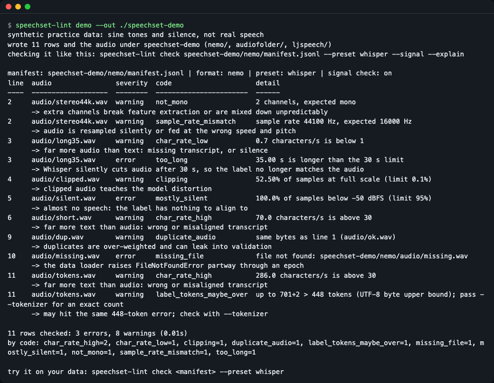
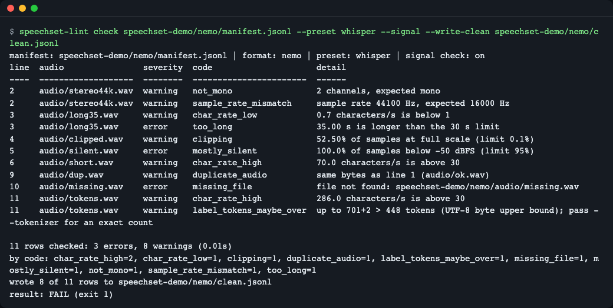
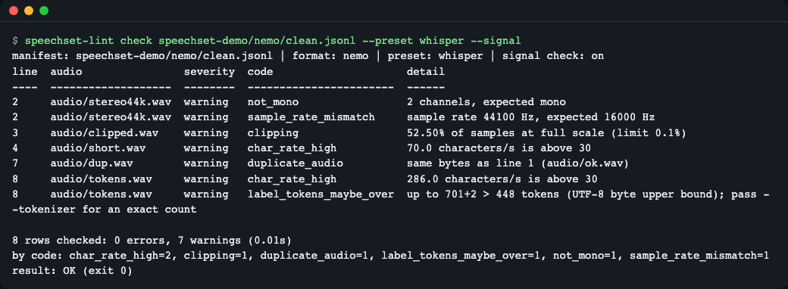
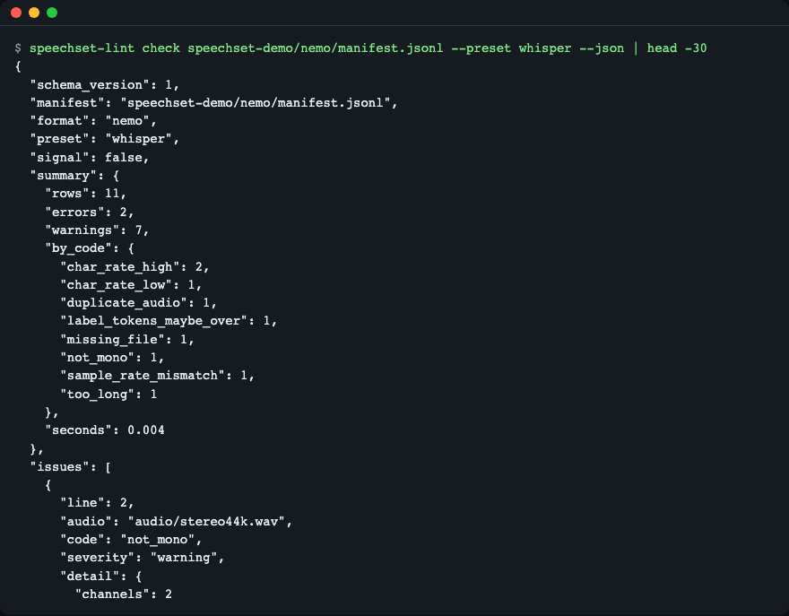
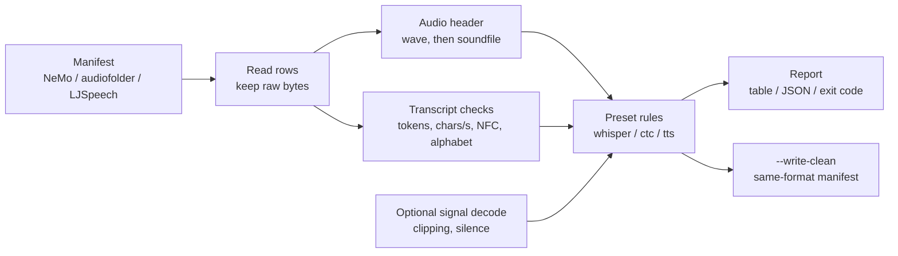

# speechset-lint

**English** | [한국어](README.ko.md)

Pre-flight lint for speech fine-tuning datasets. One command reads your manifest (NeMo JSONL, Hugging Face audiofolder, LJSpeech) without converting it, checks audio headers and transcripts for Whisper, wav2vec2 CTC or TTS training, and prints a report with line numbers and reasons. It can also write a cleaned manifest in the same format. No torch needed.

It catches the problems that otherwise show up hours into training: `size of tensor a (449) must match the size of tensor b (448)`, CTC loss turning `inf`, and Whisper silently cutting clips after 30 seconds.


*The built-in demo builds a synthetic practice dataset (sine tones and silence, not real speech) and shows 10 kinds of issues, each with a line number and a reason.*

## Who this is for
- You are about to fine-tune Whisper and want to know which clips are over 30 s or over 448 label tokens.
- You are training wav2vec2 with CTC and want to find transcripts that are too long for their audio before the loss goes `inf`.
- You have a TTS dataset in LJSpeech layout and want to find wrong sample rates, stereo files, clipped or silent clips, and duplicates.
- You want a CI step that fails when a dataset manifest has errors.

## Install
```bash
# prerequisite: uv (https://docs.astral.sh/uv/)
curl -LsSf https://astral.sh/uv/install.sh | sh
uv tool install git+https://github.com/LeeGyeongPil/speechset-lint
# optional: exact label token counts from a tokenizer.json
uv tool install "speechset-lint[tokens] @ git+https://github.com/LeeGyeongPil/speechset-lint"
```
Or from PyPI: `pip install speechset-lint` (extra: `pip install "speechset-lint[tokens]"`).

Requires Python 3.11 or newer. Reading audio uses `soundfile`, which bundles libsndfile on common platforms; on a minimal Linux image install `libsndfile1` if `import soundfile` fails.

## Quick start
```bash
speechset-lint demo --out ./speechset-demo
```
```text
synthetic practice data: sine tones and silence, not real speech
wrote 11 rows and the audio under speechset-demo (nemo/, audiofolder/, ljspeech/)
checking it like this: speechset-lint check speechset-demo/nemo/manifest.jsonl --preset whisper --signal --explain

manifest: speechset-demo/nemo/manifest.jsonl | format: nemo | preset: whisper | signal check: on
line  audio                severity  code                     detail
----  -------------------  --------  -----------------------  ------
2     audio/stereo44k.wav  warning   not_mono                 2 channels, expected mono
      -> extra channels break feature extraction or are mixed down unpredictably
2     audio/stereo44k.wav  warning   sample_rate_mismatch     sample rate 44100 Hz, expected 16000 Hz
      -> audio is resampled silently or fed at the wrong speed and pitch
3     audio/long35.wav     warning   char_rate_low            0.7 characters/s is below 1
      -> far more audio than text: missing transcript, or silence
3     audio/long35.wav     error     too_long                 35.00 s is longer than the 30 s limit
      -> Whisper silently cuts audio after 30 s, so the label no longer matches the audio
4     audio/clipped.wav    warning   clipping                 52.50% of samples at full scale (limit 0.1%)
      -> clipped audio teaches the model distortion
5     audio/silent.wav     error     mostly_silent            100.0% of samples below -50 dBFS (limit 95%)
      -> almost no speech: the label has nothing to align to
6     audio/short.wav      warning   char_rate_high           70.0 characters/s is above 30
      -> far more text than audio: wrong or misaligned transcript
9     audio/dup.wav        warning   duplicate_audio          same bytes as line 1 (audio/ok.wav)
      -> duplicates are over-weighted and can leak into validation
10    audio/missing.wav    error     missing_file             file not found: speechset-demo/nemo/audio/missing.wav
      -> the data loader raises FileNotFoundError partway through an epoch
11    audio/tokens.wav     warning   char_rate_high           286.0 characters/s is above 30
      -> far more text than audio: wrong or misaligned transcript
11    audio/tokens.wav     warning   label_tokens_maybe_over  up to 701+2 > 448 tokens (UTF-8 byte upper bound); pass --tokenizer for an exact count
      -> may hit the same 448-token error; check with --tokenizer

11 rows checked: 3 errors, 8 warnings (0.01s)
by code: char_rate_high=2, char_rate_low=1, clipping=1, duplicate_audio=1, label_tokens_maybe_over=1, missing_file=1, mostly_silent=1, not_mono=1, sample_rate_mismatch=1, too_long=1

try it on your data: speechset-lint check <manifest> --preset whisper
```
This is the full output in an English locale (the elapsed time in parentheses changes from run to run). The demo command itself exits with `0`. Each row is one problem: the manifest line, the audio file, a severity (`error` stops training or corrupts it, `warning` is worth a look), a stable code, and the numbers behind it. The `->` line, from `--explain`, says what the problem causes in training.

If your system language is Korean, the output is in Korean; add `--lang en` to get the English screen above (see [Configuration](#configuration)).

Now run it on your data:
```bash
speechset-lint check path/to/manifest.jsonl --preset whisper
```

## Usage
`speechset-lint check MANIFEST [options]` and `speechset-lint demo [--out DIR] [--force]`.

| Option | What it does | Example |
|---|---|---|
| `--preset whisper\|ctc\|tts` | Target model family; sets limits and severities (default `whisper`) | `--preset ctc` |
| `--format auto\|nemo\|audiofolder\|ljspeech` | Manifest format (default: auto-detect) | `--format ljspeech` |
| `--tokenizer PATH` | `tokenizer.json` for exact label token counts (needs the `[tokens]` extra) | `--tokenizer whisper/tokenizer.json` |
| `--extra-tokens N` | Tokens your training code adds around each label (default 2) | `--extra-tokens 4` |
| `--alphabet PATH` | `vocab.json` or one-character-per-line file; other characters are reported | `--alphabet vocab.json` |
| `--sample-rate HZ` | Expected sample rate (default from the preset) | `--sample-rate 22050` |
| `--min-seconds` / `--max-seconds` | Clip length limits in seconds | `--max-seconds 20` |
| `--min-cps` / `--max-cps` | Limits for non-space characters per second | `--max-cps 25` |
| `--audio-ext EXT` | Audio extension for LJSpeech ids (default `wav`) | `--audio-ext flac` |
| `--text-field NAME\|INDEX` | Transcript column or field (LJSpeech: 0-based column) | `--text-field sentence` |
| `--signal` / `--no-signal` | Decode audio to find clipping and silence (default on only for `tts`) | `--signal` |
| `--no-dedupe` | Skip the duplicate-audio hash check | |
| `--json` | Print a JSON report instead of the table | `--json > report.json` |
| `--write-clean PATH` | Write a same-format manifest without the failing rows | `--write-clean clean.jsonl` |
| `--drop error\|warning` | Which rows `--write-clean` removes (default `error`) | `--drop warning` |
| `--fail-on error\|warning` | Lowest severity that makes the exit code 1 | `--fail-on warning` |
| `--explain` | Add a line saying what each issue causes | |
| `--force` (demo) | Write the demo into a non-empty folder that this demo did not create (otherwise it is refused with exit 2) | `speechset-lint demo --out ./mine --force` |
| `--lang en\|ko` | Screen language (global option, goes before the command) | `speechset-lint --lang ko check ...` |

Exit codes: `0` nothing at the failing level, `1` issues found, `2` usage or input error (missing manifest, alphabet or tokenizer file, unknown format, a manifest that is not UTF-8, a negative number for a numeric option, a `--text-field` that does not exist, `--write-clean` pointing at the input file or at another folder, `demo --out` pointing at a non-empty folder). Input errors print one `error:` line, plus a `tip:` line only when there is a ready-to-use command to suggest, and never a traceback. Messages are printed in the `--lang` language.

### Presets
| | `whisper` | `ctc` | `tts` |
|---|---|---|---|
| Sample rate | 16000 Hz (warning) | 16000 Hz (warning) | 22050 Hz (error) |
| Length | over 30 s is an error | CTC alignability instead | over 20 s warning, under 1 s warning |
| Label | over 448 tokens is an error | characters outside `--alphabet` are an error | |
| Stereo | warning | warning | error |
| Signal checks | off | off | on |

Checks shared by all presets: `missing_file`, `unreadable_audio`, `empty_text` (errors), `duration_mismatch`, `char_rate_high`, `char_rate_low`, `not_nfc`, `control_chars`, `duplicate_audio`, `repeated_path`, `clipping` (warnings), `mostly_silent` (error; needs `--signal`).

### Scenario 1: write a cleaned manifest
Step 1. Check the demo manifest and write the rows without errors to `clean.jsonl`:
```bash
speechset-lint check speechset-demo/nemo/manifest.jsonl --preset whisper --signal --write-clean speechset-demo/nemo/clean.jsonl
```
```text
manifest: speechset-demo/nemo/manifest.jsonl | format: nemo | preset: whisper | signal check: on
line  audio                severity  code                     detail
----  -------------------  --------  -----------------------  ------
2     audio/stereo44k.wav  warning   not_mono                 2 channels, expected mono
2     audio/stereo44k.wav  warning   sample_rate_mismatch     sample rate 44100 Hz, expected 16000 Hz
3     audio/long35.wav     warning   char_rate_low            0.7 characters/s is below 1
3     audio/long35.wav     error     too_long                 35.00 s is longer than the 30 s limit
4     audio/clipped.wav    warning   clipping                 52.50% of samples at full scale (limit 0.1%)
5     audio/silent.wav     error     mostly_silent            100.0% of samples below -50 dBFS (limit 95%)
6     audio/short.wav      warning   char_rate_high           70.0 characters/s is above 30
9     audio/dup.wav        warning   duplicate_audio          same bytes as line 1 (audio/ok.wav)
10    audio/missing.wav    error     missing_file             file not found: speechset-demo/nemo/audio/missing.wav
11    audio/tokens.wav     warning   char_rate_high           286.0 characters/s is above 30
11    audio/tokens.wav     warning   label_tokens_maybe_over  up to 701+2 > 448 tokens (UTF-8 byte upper bound); pass --tokenizer for an exact count

11 rows checked: 3 errors, 8 warnings (0.01s)
by code: char_rate_high=2, char_rate_low=1, clipping=1, duplicate_audio=1, label_tokens_maybe_over=1, missing_file=1, mostly_silent=1, not_mono=1, sample_rate_mismatch=1, too_long=1
wrote 8 of 11 rows to speechset-demo/nemo/clean.jsonl
result: FAIL (exit 1)
```

*Step 1. Three rows have errors (lines 3, 5 and 10), so 8 of 11 rows are written to `clean.jsonl` and the run exits with 1.*

Step 2. Check the cleaned file again:
```bash
speechset-lint check speechset-demo/nemo/clean.jsonl --preset whisper --signal
```
```text
manifest: speechset-demo/nemo/clean.jsonl | format: nemo | preset: whisper | signal check: on
line  audio                severity  code                     detail
----  -------------------  --------  -----------------------  ------
2     audio/stereo44k.wav  warning   not_mono                 2 channels, expected mono
2     audio/stereo44k.wav  warning   sample_rate_mismatch     sample rate 44100 Hz, expected 16000 Hz
3     audio/clipped.wav    warning   clipping                 52.50% of samples at full scale (limit 0.1%)
4     audio/short.wav      warning   char_rate_high           70.0 characters/s is above 30
7     audio/dup.wav        warning   duplicate_audio          same bytes as line 1 (audio/ok.wav)
8     audio/tokens.wav     warning   char_rate_high           286.0 characters/s is above 30
8     audio/tokens.wav     warning   label_tokens_maybe_over  up to 701+2 > 448 tokens (UTF-8 byte upper bound); pass --tokenizer for an exact count

8 rows checked: 0 errors, 7 warnings (0.01s)
by code: char_rate_high=2, clipping=1, duplicate_audio=1, label_tokens_maybe_over=1, not_mono=1, sample_rate_mismatch=1
result: OK (exit 0)
```

*Step 2. The cleaned file has no errors, so the run exits with 0. Warnings stay, because `--drop` defaults to `error`. Line numbers now refer to `clean.jsonl`.*

The kept lines are byte-for-byte the same as in the original file, and the cleaned file keeps the original format. Relative audio paths must stay valid, so `--write-clean` refuses to write to another folder for NeMo-style relative paths (exit 2, with the reason).

### Scenario 2: use it in CI
```bash
speechset-lint check data/manifest.jsonl --preset whisper --json > report.json
```
To see what the report looks like, print the first 30 lines for the demo manifest:
```bash
speechset-lint check speechset-demo/nemo/manifest.jsonl --preset whisper --json | head -30
```

*The JSON report has `schema_version`, a `summary` (rows, errors, warnings, count by code) and an `issues` list. Codes do not change with the screen language. Without `--signal`, the whisper preset skips the signal checks, so this run has 2 errors instead of 3.*

The command exits with `1` when there are errors, so a CI job fails by itself. Add `--fail-on warning` to be stricter.

### Scenario 3: exact token counts and a CTC vocabulary
```bash
speechset-lint check train.jsonl --preset whisper --tokenizer tokenizer.json
speechset-lint check train.jsonl --preset ctc --alphabet vocab.json
```
With a tokenizer (needs the `[tokens]` extra), the label token count includes special tokens plus `--extra-tokens`; 448 passes and 449 is `label_tokens_over` (error). Without one, the tool uses a UTF-8 byte count as an upper bound and only reports `label_tokens_maybe_over` (warning). For CTC, the encoder length of the clip (49 frames for 1.0 s at 16 kHz) must be at least the number of characters plus repeated neighbours, otherwise `ctc_unalignable`.

### Use from Python
```python
from speechset_lint import check, write_clean

report = check("speechset-demo/nemo/manifest.jsonl", preset="whisper", signal=True)
print(report.summary["errors"], report.summary["warnings"])
for issue in report.issues[:3]:
    print(issue.line_no, issue.code, issue.severity)
if report.has_errors():
    print(write_clean(report, "speechset-demo/nemo/clean2.jsonl"))
```
Output of this snippet on the demo data:
```text
3 8
2 not_mono warning
2 sample_rate_mismatch warning
3 char_rate_low warning
8
```

## Configuration
| Name | Meaning |
|---|---|
| `--lang en\|ko` | Screen language. Highest priority. |
| `SPEECHSET_LINT_LANG` | Same, as an environment variable (`en` or `ko`). |
| `LC_ALL`, `LC_MESSAGES`, `LANG` | Used last; anything that is not Korean falls back to English. |

Korean screen: `speechset-lint --lang ko demo`. JSON `code` values stay the same in both languages.

No API keys or network access are needed. This tool has no mock mode; the demo is a real run on a synthetic dataset.

## How it works

1. The manifest format is detected and every row keeps its original bytes.
2. Audio headers are read first (standard `wave`, then `soundfile` for formats `wave` cannot read, such as float WAV on Python before 3.15), so no full decode is needed.
3. Transcripts are checked for length in tokens, characters per second, Unicode form and allowed characters.
4. The preset decides which checks are on and whether each is an error or a warning.
5. The report is a table or JSON with a matching exit code; `--write-clean` writes the kept original lines.

## When to use it
- Good fit: a quick, torch-free check of a manifest before fine-tuning, in the format you already have, with a report you can run in CI and a cleaned file as output.
- For NeMo-specific data processing pipelines, see [NeMo Speech Data Processor](https://github.com/NVIDIA/NeMo-speech-data-processor). For Lhotse cut sets, see the `lhotse validate` command in [Lhotse](https://github.com/lhotse-speech/lhotse). For listening and editing clips by hand, see [Speech Data Explorer](https://github.com/NVIDIA/NeMo/tree/main/tools/speech_data_explorer).

## Troubleshooting
| Symptom | Cause | Fix |
|---|---|---|
| Exit code 2: `error: manifest not found: nope.jsonl; check the path` | Wrong manifest path | Check the path |
| Exit code 2: `error: notes.txt: cannot tell the format (no 'file_name' header, no '\|' separator, not JSON); pass --format nemo\|audiofolder\|ljspeech to choose explicitly` | The file is not one of the three formats, or auto-detection could not decide | Pass `--format nemo`, `audiofolder` or `ljspeech` |
| Exit code 2: `error: u16.jsonl: the file starts with a UTF-16/32 byte order mark; re-save it as UTF-8` | The manifest was saved as UTF-16/32 | Re-save the manifest as UTF-8 |
| Exit code 2: `error: alphabet file not found: nope.json; check the --alphabet path` (or `tokenizer file not found: ...`) | Wrong `--alphabet` or `--tokenizer` path | Check the path; for a tokenizer, download `tokenizer.json` from the model repo (the message shows an example URL) |
| Exit code 2: `speechset-lint check: error: argument --max-seconds: invalid value: -1 (expected a number of zero or more)` | A negative number (or 0 for `--sample-rate`) was given to a numeric option | Use a number of zero or more |
| Exit code 2: `--text-field 'zzz' is not a key of the first JSON object (found: audio_filepath, text, duration)` | The transcript field name does not exist in the manifest | Use one of the keys listed after `found:` |
| Exit code 2: `error: mine is not empty and was not created by this demo; refusing to write into it` | `demo --out` points at a folder with other files | Use a new or empty folder, or add `--force` (the `tip:` line says the same) |
| Exit code 2: `error: refusing to overwrite the input manifest ...` | `--write-clean` points at the input manifest | Pick another name; the `tip:` line shows one, e.g. `--write-clean speechset-demo/nemo/clean.jsonl` |
| Exit code 2: `error: cannot write sub/clean.jsonl: audio paths in this nemo manifest are relative to ...` | Relative audio paths cannot move to another folder | Write the cleaned file next to the manifest (the `tip:` line shows the path) |
| Every LJSpeech row reports `missing_file ... (a file with the same name exists as .flac; check --audio-ext or the path)` | Ids have no extension and the audio is not `.wav` | Add `--audio-ext flac` |
| `mostly_silent` and `clipping` never appear | Signal checks are off for `whisper` and `ctc` | Add `--signal` |
| Only `label_tokens_maybe_over` warnings, over-estimated for Korean | No tokenizer, so the UTF-8 byte upper bound is used (Hangul is 3 bytes per character) | Pass `--tokenizer tokenizer.json` with the `[tokens]` extra installed |
| MP3 files are unreadable | MP3 support depends on your libsndfile version | Convert to WAV or FLAC |

## Development
```bash
uv sync
uv run pytest -q
```
Bugs and suggestions are welcome as issues. Changes are listed in [CHANGELOG.md](CHANGELOG.md).

## License
MIT. The demo dataset is generated synthetic audio; no third-party data or models are bundled.
